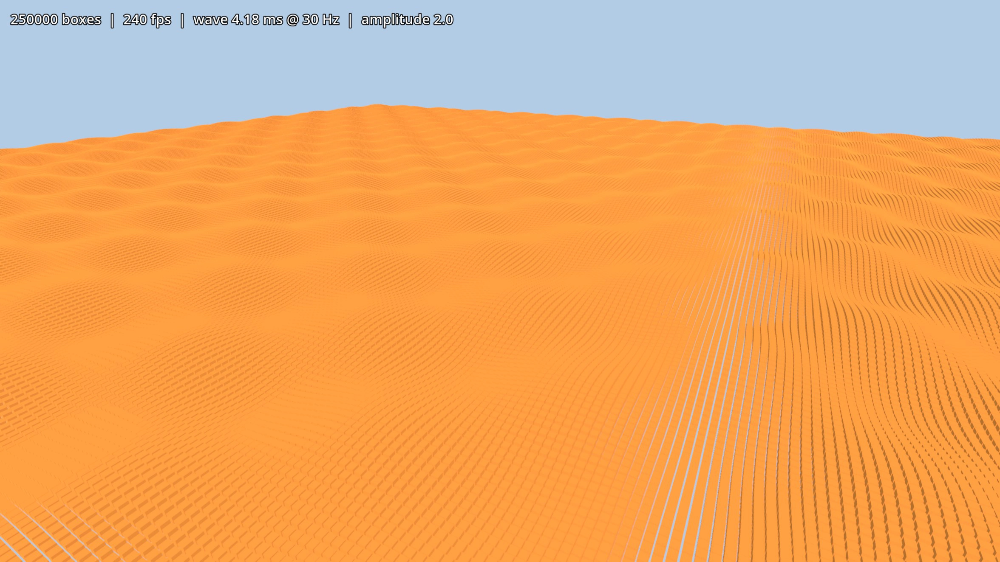

# InstancedRenderer3D

GPU-instanced mesh rendering for Godot 4 as a GDExtension. `InstancedMesh3D`
nodes are batched into MultiMeshes by world, mesh, material and spatial chunk,
with LOD, physics interpolation and sleeping of resting instances. Works in the
editor and at runtime.

Requires Godot 4.4+

## Install

Download the zip from the latest GitHub release and extract it into your
project, or copy `demo/addons/instanced_renderer`.

## Build

```bash
git submodule update --init
scons
```

## Usage

Add an `InstancedMesh3D` node and set its `mesh`. Nodes with matching settings
in the same chunk share one draw call.

- `is_static`: the node frees itself at runtime; its instance stays drawn.
- `chunk_size`: batching grid size; also how fine culling and LOD are.
- `lods`: `InstancedMeshLOD` entries (`mesh`, `distance`); `mesh` is level 0.
- `visibility_range_end`: stop drawing beyond this distance.

Without nodes:

```gdscript
var r := InstanceManager.get_renderer(get_world_3d(), mesh)
var id := r.add_instance(transform)
r.update_instance(id, new_transform)
r.remove_instance(id)
```

Project settings are under `instanced_renderer/`.


